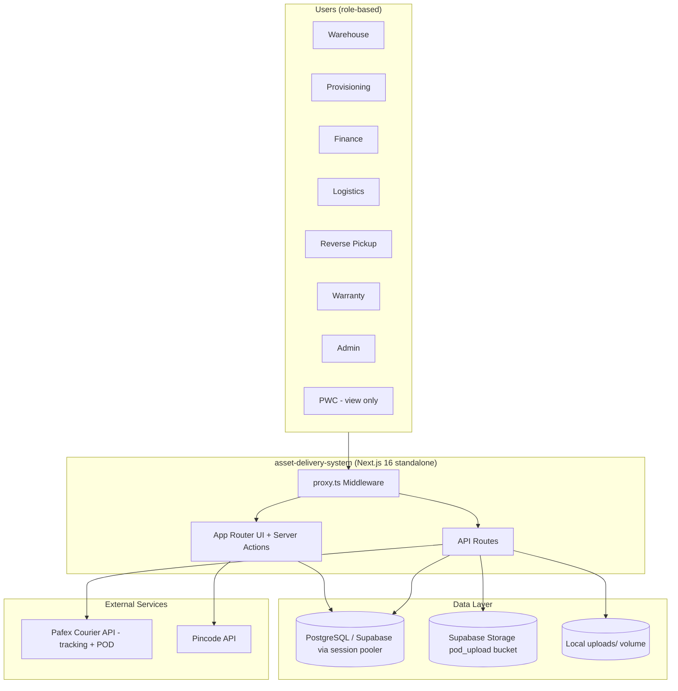
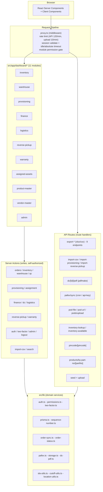
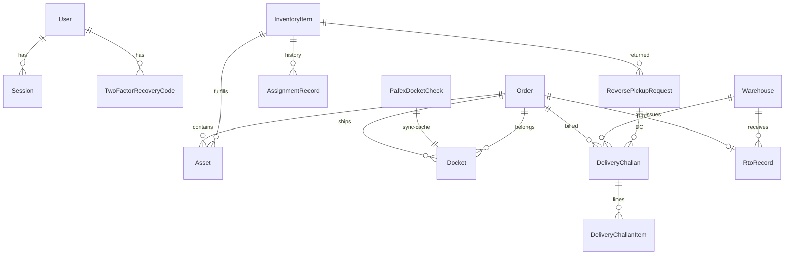
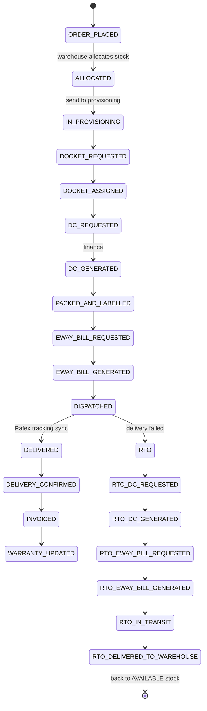
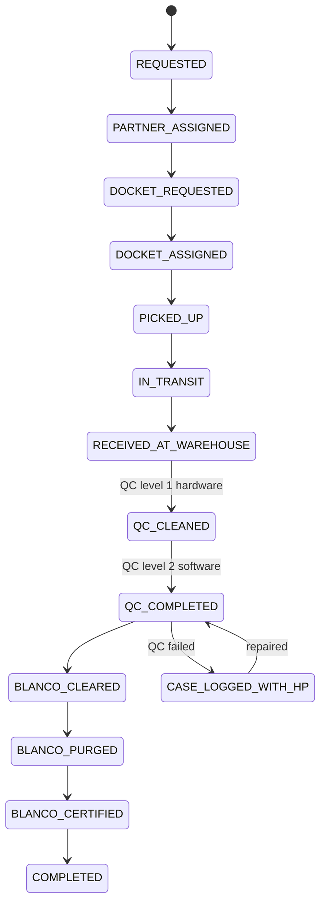
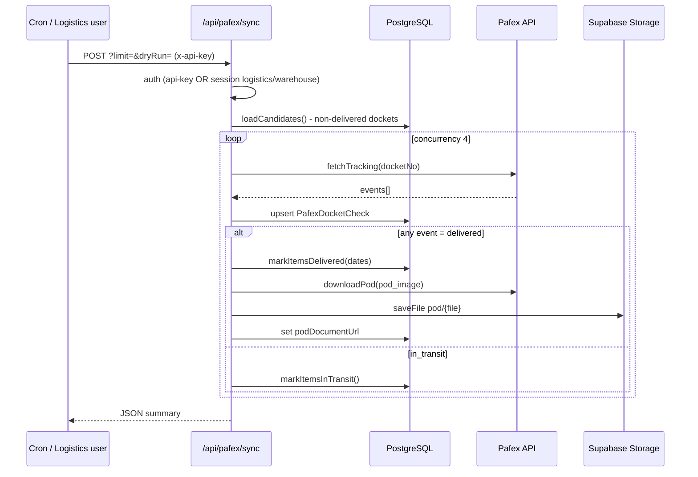
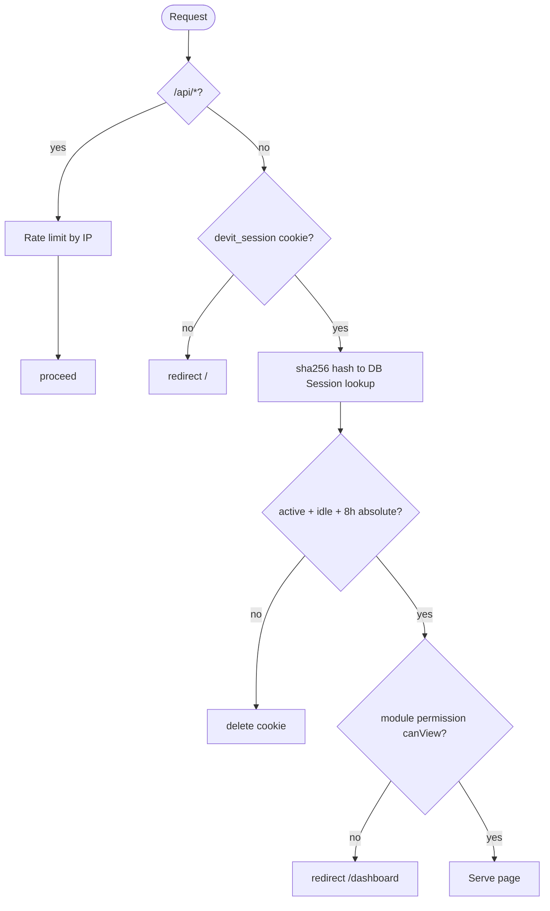
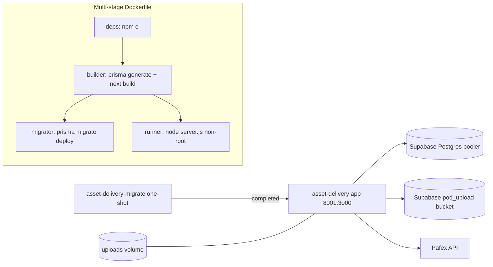

# Asset Delivery System — Architecture

PWC / HP asset delivery and reverse-pickup platform. Next.js 16 (App Router) + React 19 +
TypeScript + Tailwind v4 + Prisma 7 on PostgreSQL (Supabase), with Pafex courier tracking
and Supabase Storage for proof-of-delivery documents.

---

## 1. System Context (High Level)

## 2. Application Layer (Next.js App Router)

## 3. Data Model (Core ERD)

## 4. Order Lifecycle (Forward Flow)

## 5. Reverse Pickup Lifecycle

## 6. Pafex Tracking + POD Sync

## 7. Auth & Security Flow

## 8. Deployment Architecture (Docker)

---

## Tech Stack

| Layer | Technology |
|-------|-----------|
| Framework | Next.js 16 (App Router, `output: standalone`) |
| UI | React 19, Tailwind CSS v4, Base UI, lucide-react, shadcn |
| Language | TypeScript 5 |
| ORM / DB | Prisma 7 + `@prisma/adapter-pg`, PostgreSQL (Supabase pooler) |
| Object storage | Supabase Storage (`pod_upload` bucket) or local `uploads/` |
| Auth | Custom sessions (sha256-hashed tokens), bcryptjs, otplib TOTP 2FA |
| Documents | pdfmake (DC PDF), xlsx + csv-parse (imports/exports) |
| Courier | Pafex HTTP API (tracking + POD download) |
| Deploy | Docker multi-stage, docker-compose, nginx |

## Modules (role-gated)

| Module | Path | Roles with access |
|--------|------|-------------------|
| Inventory | `/dashboard/inventory` | ADMIN, WAREHOUSE, PWC (view) |
| Assigned Assets | `/dashboard/assigned-assets` | ADMIN, LOGISTICS (view), PWC |
| Warehouse | `/dashboard/warehouse` | ADMIN, WAREHOUSE, PWC |
| Provisioning | `/dashboard/provisioning` | ADMIN, PROVISIONING, PWC |
| Finance | `/dashboard/finance` | ADMIN, FINANCE, PWC |
| Logistics | `/dashboard/logistics` | ADMIN, LOGISTICS, PWC |
| Reverse Pickup | `/dashboard/reverse-pickup` | ADMIN, REVERSE_PICKUP, PWC |
| Warranty | `/dashboard/warranty` | ADMIN, WARRANTY, PWC |
| Product Master | `/dashboard/product-master` | ADMIN, PWC |
| Vendor Master | `/dashboard/vendor-master` | ADMIN, PWC |
| Admin | `/dashboard/admin` | ADMIN |

## Core Data Models (17)

| Model | Purpose |
|-------|---------|
| User | Accounts, role, JSON permissions, 2FA fields |
| Session | Hashed session tokens, idle + absolute expiry |
| TwoFactorRecoveryCode | Hashed 2FA recovery codes |
| Order | Delivery order + OrderStatus workflow |
| RtoRecord | Return-to-origin receipt per order |
| InventoryItem | Central asset record (serial, assignment, SLA, QC, POD) |
| AssignmentRecord | Assignment history per asset |
| DropdownOption | Managed dropdown values (entity/purpose/imageType) |
| Asset | Order-to-inventory link, provisioning status |
| DeliveryRecord | Imported delivery sheet rows |
| ReversePickupRequest | Reverse pickup workflow + Blancco/QC + HP case |
| VendorMaster | Vendor records (GRN) |
| ProductMaster | Make/model/HSN/GST product catalog |
| Docket | Shipment docket + courier tracking |
| PafexDocketCheck | Sync cache to avoid re-querying unknown dockets |
| Warehouse | Warehouse locations |
| DeliveryChallan | DC header (finance) |
| DeliveryChallanItem | DC line items |

## Enums

- **OrderStatus** (33 values): `ORDER_PLACED`, `ALLOCATED`, `IN_PROVISIONING`, `DOCKET_REQUESTED`, `DOCKET_ASSIGNED`, `DC_REQUESTED`, `DC_GENERATED`, `PACKED_AND_LABELLED`, `EWAY_BILL_REQUESTED`, `EWAY_BILL_GENERATED`, `DISPATCHED`, `DELIVERED`, `RTO*`, `DELIVERY_CONFIRMED`, `INVOICED`, `WARRANTY_UPDATED`, `CANCELLED`.
- **ReversePickupStatus** (35 values): `REQUESTED` … `QC_CLEANED` … `BLANCO_CERTIFIED`, `COMPLETED`, plus error/parking states (`CASE_LOGGED_WITH_HP`, `RTO_CASE`, `LOST_DEVICE`, `ON_HOLD`, …).
- **InventoryStatus**: `NEW`, `AVAILABLE`, `QC_PENDING`, `ALLOCATED`, `DEFECTIVE`, `RETIRED`.
- **UserRole**: `ADMIN`, `WAREHOUSE`, `PROVISIONING`, `FINANCE`, `LOGISTICS`, `WARRANTY`, `REVERSE_PICKUP`, `PWC`.

## API Routes

| Route | Method | Purpose |
|-------|--------|---------|
| `/api/export-{inventory,warehouse,finance,logistics,reverse-pickup,provisioning,cases,pods,assigned-assets}` | GET | Export data (xlsx/csv) |
| `/api/import-csv`, `/api/import-provisioning`, `/api/import-reverse-pickup` | POST | Bulk imports |
| `/api/dc/[id]/pdf` | GET | Generate Delivery Challan PDF |
| `/api/dc/dc-by-order/[orderId]` | GET | DC lookup by order |
| `/api/pafex/sync` | POST | Pafex tracking + POD sync (api-key or session) |
| `/api/pod-file`, `/api/pod-url`, `/api/pods/upload` | GET/POST | POD file read/URL/upload |
| `/api/inventory-lookup`, `/api/inventory-available` | GET | Inventory search |
| `/api/pincode/[pincode]` | GET | Pincode lookup |
| `/api/products/by-part-no/[partNo]` | GET | Product master lookup |
| `/api/auth/clear-session`, `/api/seed`, `/api/upload` | POST/GET | Utility |

## Security

- Session cookie `devit_session`: httpOnly, SameSite=lax, secure-flag optional; token stored **sha256-hashed** in DB.
- Idle timeout 15 min (slidden, DB-write only near expiry) + 8h absolute timeout.
- 2FA (TOTP via otplib) with signed `devit_2fa_pending` cookie (HMAC, 5-min TTL) and hashed recovery codes.
- `proxy.ts` middleware enforces auth + module permissions per route prefix and per-IP rate limits.
- Server Actions self-authorize via `requireAuth()` + `requirePermission()` (public POST endpoints).
- Security headers set in `next.config.ts` (HSTS, X-Frame-Options DENY, nosniff, etc.).
- Path traversal guard on all POD storage paths (`assertSafePodPath`).
